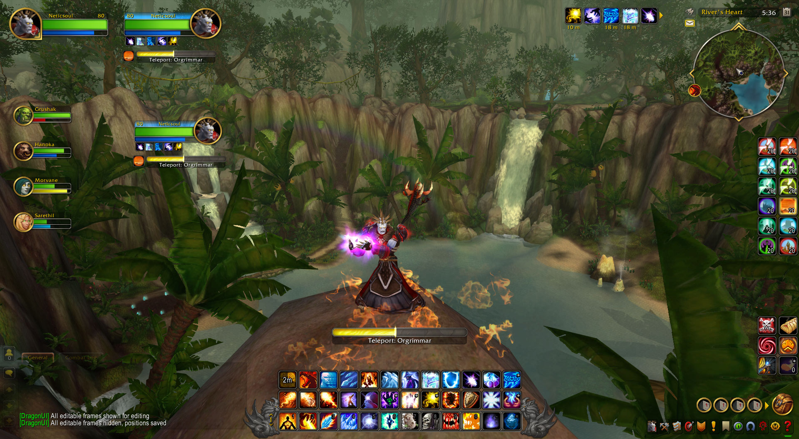
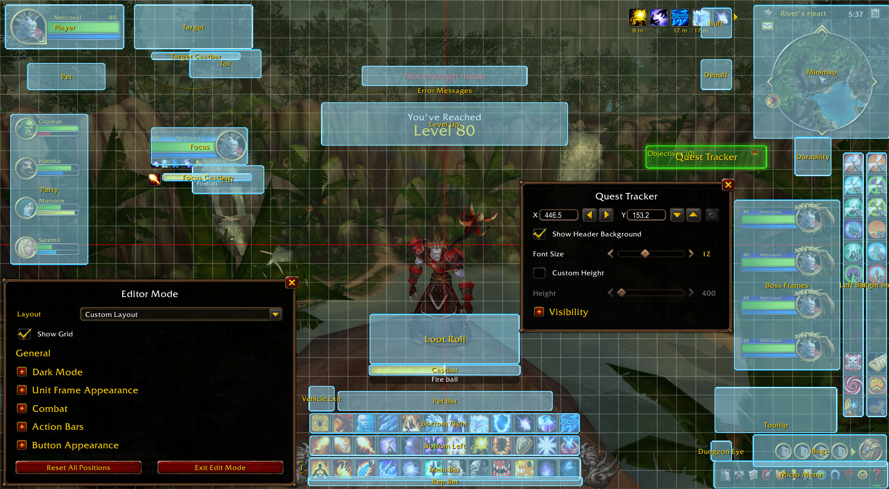
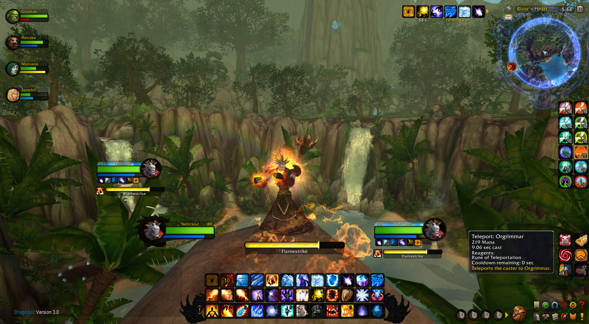
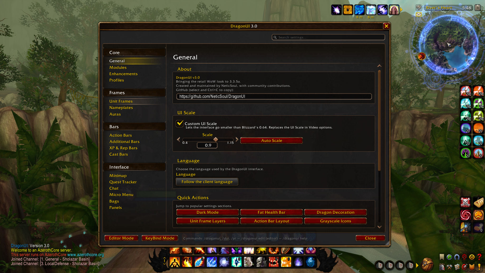

# 🐉 DragonUI for Conquest Of AzerothCore servers

### Support me ❤️ ⬎

## 📥 Download

- **[Latest release](https://github.com/PentSec/DragonUI-CoA/releases/latest)**: recommended.
- [Main branch](https://github.com/PentSec/DragonUI-CoA/archive/refs/heads/main.zip): the most recent features and fixes, less tested.

**A modular, retail-inspired UI addon for Conquest of AzerothCore Servers, Conquest of Azeroth.**

Found a bug? [Open an issue](https://github.com/PentSec/DragonUI-CoA/issues).

### 🐉 BASED ON: DragonUI for 3.3.5a BY NeticSoul

A modular, retail-inspired UI addon for World of Warcraft 3.3.5a (Wrath of the Lich King).

<kbd></kbd>

<strong>See more screenshots (click to expand)</strong>

<kbd></kbd>

<kbd></kbd>

<kbd></kbd>

## 📦 Installation

1. Download the ZIP and extract it.
2. Copy both `DragonUI` and `DragonUI_Options` to `World of Warcraft/Interface/AddOns/`.
3. Start the game and check that both are enabled in the AddOns list.
4. Open the settings with `/dui`.

**Upgrading from an old version?**

1. Delete the old `DragonUI` and `DragonUI_Options` folders from `Interface/AddOns/`.
2. Install the new version with the steps above.
3. In game, type `/dui`, open **Profiles** and click **Reset Profile** to start from the new defaults. This erases your previous settings and frame positions.

## ✨ Features

### ⚙️ Core UI

- 🧩 **Modular system:** enable or disable any major UI component independently.
- 🎛️ **Settings panel** with hundreds of options, profiles and a search box that takes you straight to any of them.
- ✏️ **Edit Mode:** move nearly every UI element, with live X/Y coordinates, pixel-by-pixel controls and each frame's settings right next to it.
- 📋 **Layout Presets:** save, load, import and export full UI layouts using shareable codes.
- 👁️ **Visibility rules:** show frames on hover or only in combat, hide them in combat or keep them hidden.
- 🔍 **Custom UI scale** from 0.40 to 1.15, past Blizzard's own limits.
- 🌍 **Localization** for English, Spanish (ES/MX), German, French, Portuguese, Russian, Korean, and Simplified and Traditional Chinese.

### 🖼️ Frames and Bars

- 💚 **Unit frames** for player, target, focus, party, pet, ToT and ToF in retail HD or WoW Forever art, plus boss frames.
- 🐉 **Unit frame extras:** elite dragon decoration, class and race portraits, fat health bar mode and a portrait-off mode (beta).
- 🩹 **Unit Frame Layers:** heal prediction, absorb shields and animated health loss overlays.
- 🏷️ **Nameplates** in a Modern or Heritage style, with cast bars, debuffs, threat colors, quest and rare icons, and a name-only mode for friendly nameplates.
- 🎯 **Action bars** with configurable grid layouts, visibility rules and button spacing, plus stance, pet, totem, vehicle and extra bars.
- 🔮 **Cast bars** for player, target and focus, with simple and detailed display modes, retail interrupts, and latency and global cooldown indicators for the player.
- 🔥 **Combo points** in the retail and WoW Forever styles.
- ⏱️ **Personal Resource Display** and **swing timers**.
- 📊 **XP and reputation bars** in two styles, independently movable.
- ✨ **Auras** with custom borders, timers and layout options.

### 🪟 Panels

- 🗺️ **World map** with a quest log side panel.
- 🛡️ **Character panel** with equipment sets that swap with your spec.
- 📖 **Spellbook**, plus **talents and glyphs**.
- 🔨 **Professions** window with recipe favorites, filters and search.
- 🐾 **Pets & Mounts** collection.
- ❗ Retail-style **quest dialogs, vendor, mailbox, flight map and loot window**.
- 📦 **Addon manager** in the Esc menu.

### 🎒 Inventory and Navigation

- 👜 **Bags:** a retail skin or the all-in-one **Bagster** window.
- 🧹 **Sorting** for bags, bank and guild bank, with slot locking.
- 🧭 **Minimap:** retail or WoW Forever style, round or square (compatible with SexyMap), with animated border decorations, an addon button collector and Farm Mode.
- 📜 **Quest tracker** with clickable quest items and tracked recipes.

### 🧰 Utility and Quality of Life

- 💬 **Chat enhancements:** style skins, editbox position and opacity, URL detection, chat copy, link tooltips and class-colored names.
- 💎 **Item quality borders** and item levels on gear.
- 💡 **Enhanced tooltips** with class-colored borders, and a **range indicator**.
- 🌙 **Dark Mode** with three intensity presets and a custom color picker.
- 🤖 **Automation:** auto repair, sell junk, accept invites from friends or guild, and greed or disenchant at max level.
- ⌨️ **Interactive keybinding mode** and casting on key down.
- 🎉 **Level-up banner** that shows what each new level unlocks.
- 🖥️ **DirectX 9Ex** support (`SET gxApi "d3d9ex"`).

...and many more customization options inside the settings panel (`/dui`).

## 🔧 Commands

| Command | Action |
|---------|--------|
| `/dui` | Open the settings |
| `/dui edit` | Toggle Edit Mode |
| `/dui farm` | Toggle the minimap's Farm Mode |
| `/dui help` | List every command |
| `/sort` | Sort your bags |
| `/tt <message>` | Whisper your current target |
| `/rl` | Reload the UI |

## 💬 Community

Join the Discord to get help, share your setup and follow development:

## 🏆 Hall of Fame

The people who have opened the most issues and pull requests. Updated every day.

<<<<<<< HEAD
<picture>
  <source media="(prefers-color-scheme: dark)" srcset="https://raw.githubusercontent.com/NeticSoul/DragonUI/hall-of-fame/hall-of-fame-dark.svg">
  
</picture>
=======
<!-- hall-of-fame:start -->

<picture><source media="(prefers-color-scheme: dark)" srcset="https://raw.githubusercontent.com/NeticSoul/DragonUI/hall-of-fame/rows/issuers-head-dark.svg"></picture><picture><source media="(prefers-color-scheme: dark)" srcset="https://raw.githubusercontent.com/NeticSoul/DragonUI/hall-of-fame/rows/contributors-head-dark.svg"></picture> 
<a href="https://github.com/Marewick"><picture><source media="(prefers-color-scheme: dark)" srcset="https://raw.githubusercontent.com/NeticSoul/DragonUI/hall-of-fame/rows/issuers-1-dark.svg"></picture></a><a href="https://github.com/PentSec"><picture><source media="(prefers-color-scheme: dark)" srcset="https://raw.githubusercontent.com/NeticSoul/DragonUI/hall-of-fame/rows/contributors-1-dark.svg"></picture></a> 
<a href="https://github.com/mikki33"><picture><source media="(prefers-color-scheme: dark)" srcset="https://raw.githubusercontent.com/NeticSoul/DragonUI/hall-of-fame/rows/issuers-2-dark.svg"></picture></a><a href="https://github.com/tje3d"><picture><source media="(prefers-color-scheme: dark)" srcset="https://raw.githubusercontent.com/NeticSoul/DragonUI/hall-of-fame/rows/contributors-2-dark.svg"></picture></a> 
<a href="https://github.com/Vortikai"><picture><source media="(prefers-color-scheme: dark)" srcset="https://raw.githubusercontent.com/NeticSoul/DragonUI/hall-of-fame/rows/issuers-3-dark.svg"></picture></a><a href="https://github.com/Andyk10"><picture><source media="(prefers-color-scheme: dark)" srcset="https://raw.githubusercontent.com/NeticSoul/DragonUI/hall-of-fame/rows/contributors-3-dark.svg"></picture></a> 
<a href="https://github.com/Flecked42"><picture><source media="(prefers-color-scheme: dark)" srcset="https://raw.githubusercontent.com/NeticSoul/DragonUI/hall-of-fame/rows/issuers-4-dark.svg"></picture></a><a href="https://github.com/nadugi"><picture><source media="(prefers-color-scheme: dark)" srcset="https://raw.githubusercontent.com/NeticSoul/DragonUI/hall-of-fame/rows/contributors-4-dark.svg"></picture></a> 
<a href="https://github.com/ARxenon"><picture><source media="(prefers-color-scheme: dark)" srcset="https://raw.githubusercontent.com/NeticSoul/DragonUI/hall-of-fame/rows/issuers-5-dark.svg"></picture></a><a href="https://github.com/Raz0r1337"><picture><source media="(prefers-color-scheme: dark)" srcset="https://raw.githubusercontent.com/NeticSoul/DragonUI/hall-of-fame/rows/contributors-5-dark.svg"></picture></a> 
<a href="https://github.com/kefirok"><picture><source media="(prefers-color-scheme: dark)" srcset="https://raw.githubusercontent.com/NeticSoul/DragonUI/hall-of-fame/rows/issuers-6-dark.svg"></picture></a><a href="https://github.com/sorcerer-merlin"><picture><source media="(prefers-color-scheme: dark)" srcset="https://raw.githubusercontent.com/NeticSoul/DragonUI/hall-of-fame/rows/contributors-6-dark.svg"></picture></a> 
<a href="https://github.com/Raz0r1337"><picture><source media="(prefers-color-scheme: dark)" srcset="https://raw.githubusercontent.com/NeticSoul/DragonUI/hall-of-fame/rows/issuers-7-dark.svg"></picture></a><a href="https://github.com/akawula"><picture><source media="(prefers-color-scheme: dark)" srcset="https://raw.githubusercontent.com/NeticSoul/DragonUI/hall-of-fame/rows/contributors-7-dark.svg"></picture></a> 
<a href="https://github.com/TonyG-Bot"><picture><source media="(prefers-color-scheme: dark)" srcset="https://raw.githubusercontent.com/NeticSoul/DragonUI/hall-of-fame/rows/issuers-8-dark.svg"></picture></a><a href="https://github.com/MarrowB83"><picture><source media="(prefers-color-scheme: dark)" srcset="https://raw.githubusercontent.com/NeticSoul/DragonUI/hall-of-fame/rows/contributors-8-dark.svg"></picture></a> 
<a href="https://github.com/zacone33"><picture><source media="(prefers-color-scheme: dark)" srcset="https://raw.githubusercontent.com/NeticSoul/DragonUI/hall-of-fame/rows/issuers-9-dark.svg"></picture></a><a href="https://github.com/Ahmedrn"><picture><source media="(prefers-color-scheme: dark)" srcset="https://raw.githubusercontent.com/NeticSoul/DragonUI/hall-of-fame/rows/contributors-9-dark.svg"></picture></a> 
<a href="https://github.com/jimylima00-png"><picture><source media="(prefers-color-scheme: dark)" srcset="https://raw.githubusercontent.com/NeticSoul/DragonUI/hall-of-fame/rows/issuers-10-dark.svg"></picture></a><a href="https://github.com/Stefan2102"><picture><source media="(prefers-color-scheme: dark)" srcset="https://raw.githubusercontent.com/NeticSoul/DragonUI/hall-of-fame/rows/contributors-10-dark.svg"></picture></a>

<!-- hall-of-fame:end -->
>>>>>>> 0198b0eb (docs(readme): hall of fame links follow the new ranking)

## 🙏 Credits and References

DragonUI builds on original work, adapted code and ideas from these addon authors and projects. Each entry says what was used; the licenses are listed in [`THIRD_PARTY_NOTICES.md`](DragonUI/THIRD_PARTY_NOTICES.md).

<b>Addons and references (16)</b>

| Project | Author | Contribution |
|---------|--------|-------------|
| [Dragonflight UI (Classic)](https://github.com/Karl-HeinzSchneider/WoW-DragonflightUI) | Karl-HeinzSchneider | Primary design reference; code snippets and textures adapted (MIT) |
| [New Era](https://www.curseforge.com/wow/addons/new-era-retail-ui-in-classic) | Ashgaroth | Upstream of DragonUI_NewEra; design reference for the talents, spellbook, merchant, character panel, world map and retail nameplates; talent textures obtained via it (Blizzard art) |
| [DragonUI_NewEra](https://github.com/ghbset/DragonUI_NewEra) | ghbset, [LoneBrownie](https://github.com/LoneBrownie), contributors | Art and geometry reference for the character panel, talents, merchant, collections and world map; Blizzard textures obtained via it |
| [pretty_actionbar](https://github.com/s0h2x/pretty_actionbar) / [pretty_minimap](https://github.com/s0h2x/pretty_minimap) | s0h2x | Original inspiration for the action bars and minimap; some textures obtained via them (Blizzard art) |
| [RetailUI](https://github.com/a3st/RetailUI) | a3st (Dmitriy) | Minimap, buff frame and API helper code and textures adapted (MIT) |
| [KPack](https://github.com/bkader/KPack) | bkader | Chat mods code adapted (MIT/X); source of the Combuctor code in Bagster and of the GearScoreLite formula |
| [Combuctor](https://github.com/Jaliborc/Combuctor) | Jason Greer (Tuller), João Cardoso (Jaliborc) | Bagster code adapted from Combuctor 4.2 via KPack (MIT) |
| [NotPlater](https://github.com/RichSteini/NotPlater) | RichSteini | Options panel spell-filter dialog code adapted (MIT) |
| [SexyMap](https://github.com/funkydude/SexyMap) | funkydude | Minimap border presets and rotation helper, used with permission |
| [GearScore / GearScoreLite](https://www.wowinterface.com/downloads/info14865-GearScoreLite.html) | Mirrikat45 | Character panel gear score formula |
| [BankStack](https://github.com/kemayo/wow-bankstack) | kemayo | Inspiration for the bag sort |
| [UnitFrameLayers](https://github.com/RomanSpector/UnitFrameLayers) | RomanSpector | Inspiration for the heal/absorb overlays; layer textures obtained via it (Blizzard art) |
| [SnowfallKeyPress](https://www.wowinterface.com/downloads/info15078-SnowfallKeyPress.html) | Dayn | Inspiration for casting on key down |
| [oGlow](https://github.com/haste) | haste | Item quality border concept |
| [ElvUI-WotLK](https://github.com/ElvUI-WotLK/) | ElvUI team | Pattern reference: load-on-demand options, slash commands, combat queue |
| [Quartz](https://github.com/Nevcairiel/Quartz) | Hendrik Leppkes | Latency indicator concept |

<b>Contributors (20)</b>

| Contributor | Name | Contribution |
|---------|--------|-------------|
| [PentSec](https://github.com/PentSec) | PentSec | Collaborator: Bagster rework, low HP alert and level-up modules, UI language override, version check, chat copy and pet pane fixes; original drafts of the loot skin, world map, spellbook, talents and merchant modules and the portrait-off unit frames; the spellbook artwork |
| [dadec666](https://github.com/dadec666) | dadec666 | Addon manager, square minimap style, flight map and mail skins |
| [tje3d](https://github.com/tje3d) | Moein Porkamel | Auto repair and sell junk, auto greed/disenchant, auto accept invites, minimap farm mode, tooltip cursor offsets, global cooldown indicator |
| [Andyk10](https://github.com/Andyk10) | Andyk | Spell IDs and per-character item counts in tooltips, equipped repair cost, automatic item comparison, loot window auto-hide, alt gold and channel tick fixes |
| [sorcerer-merlin](https://github.com/sorcerer-merlin) | Sorcerer Merlin | Auto-loot rows in the loot window, minimap addon button distance, minimap editor clamp fix |
| [manatactical](https://github.com/manatactical) | Manatactical | Only-target nameplate filter |
| [CrimsonHollow](https://github.com/CrimsonHollow) | CrimsonHollow | Fat Health Bar contribution |
| [RovBot](https://github.com/RovxBot) | RovBot | Action bar grid/preset system |
| [Marrow](https://github.com/MarrowB83) | Marrow (Pexie) | Micro menu, cast bar and unit frame contributions |
| [Andrew Kawula](https://github.com/akawula) | Andrew Kawula | Capture bar positioning fix |
| [WYPanda](https://github.com/1825679767) | WYPanda | Chinese localization; minimap addon-button collector, LFG and party glow fixes |
| [Štefan](https://github.com/Stefan2102) | Štefan | Default profile for new characters, chat link tooltips, nameplate fixes |
| [yetanotherneuron](https://github.com/yetanotherneuron) | yetanotherneuron (yan) | Player buff layout options and aura source tooltips; nameplate name fix |
| [ZephZae](https://github.com/thezephyrsong) | ZephZae | AbsorbsMonitor zone and scaling fixes, collections micro button; reference for bank stacking |
| [WillScarlettOhara](https://github.com/WillScarlettOhara) | WillScarlettOhara | Cast bar event matching fixes |
| [Ambitosis](https://github.com/Ambitosis) | Ambitosis | Questie compatibility fix |
| [5Buttons](https://github.com/5Buttons) | 5Buttons | Atlas system restructure |
| [Chill Guy](https://github.com/Chill-Guy-Hub) | Chill Guy | Always-hidden option for the micro menu and bag bar |
| [Raz0r](https://github.com/Raz0r1337) | Raz0r (St0ny) | German localization |
| [nadugi](https://github.com/nadugi) | nadugi | Korean localization |

Missing from the list? [Let me know!](https://github.com/PentSec/DragonUI-CoA/issues)

Thanks to everyone who tested early builds, reported bugs and translated DragonUI, and to the open-source addon community whose work made this project possible.

## 📜 License

DragonUI's own code is released under the [MIT License](LICENSE). Bundled libraries, fonts and code adapted from other projects keep their own licenses, and the SexyMap border presets are included with their author's permission - see [`THIRD_PARTY_NOTICES.md`](DragonUI/THIRD_PARTY_NOTICES.md) and [`LICENSES/`](DragonUI/LICENSES/) (both ship inside the `DragonUI/` addon folder). World of Warcraft game artwork included in the addon (most textures under `DragonUI/Textures/`) is © Blizzard Entertainment, is not covered by the MIT License, and is included only for use with the game.

## 📎 Disclaimer

DragonUI is a free, fan-made addon. No content is sold and no in-game advantages are provided. Donations are entirely voluntary. Not affiliated with or endorsed by Blizzard Entertainment.

### Support me ❤️ ⬎

